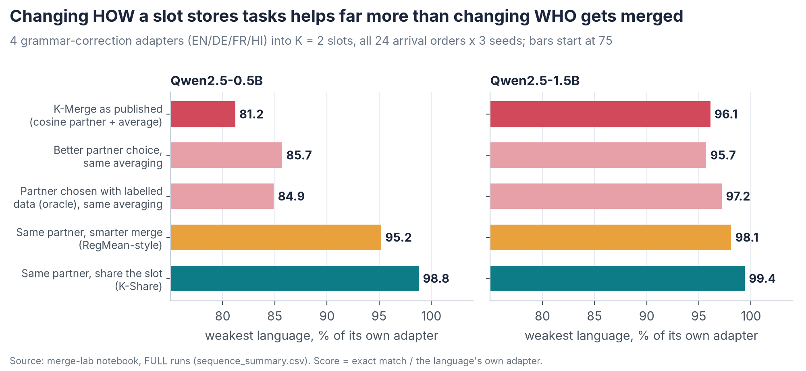
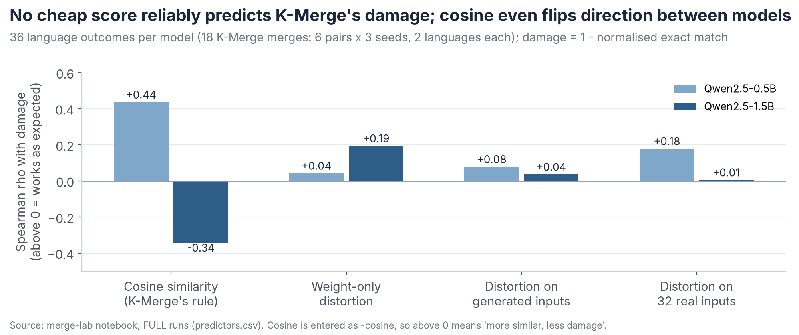
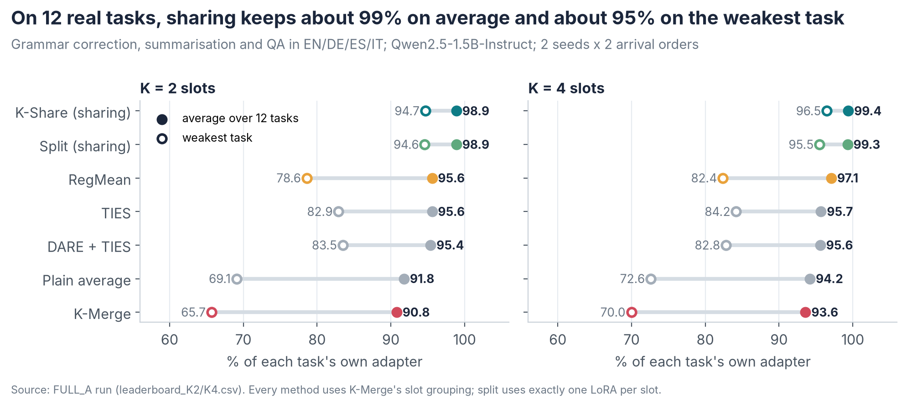
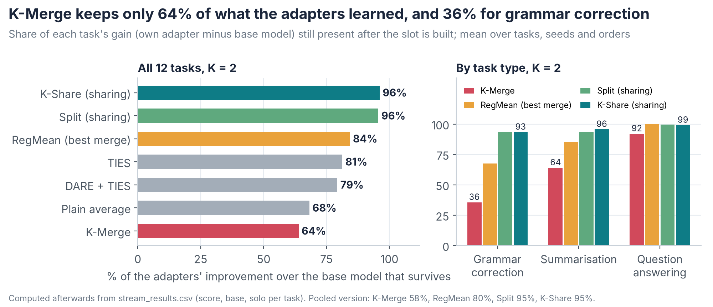
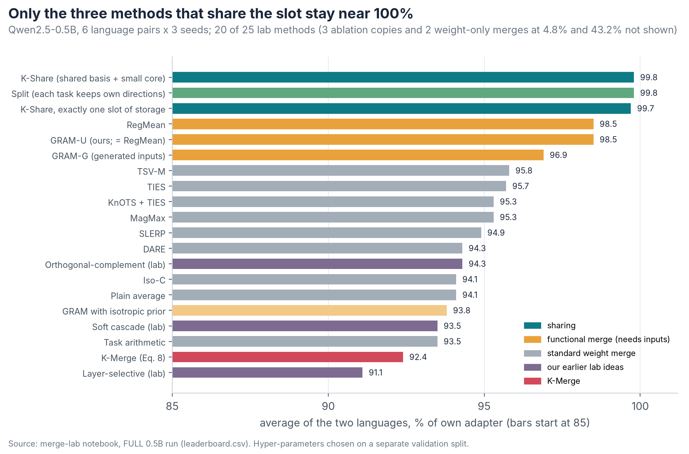
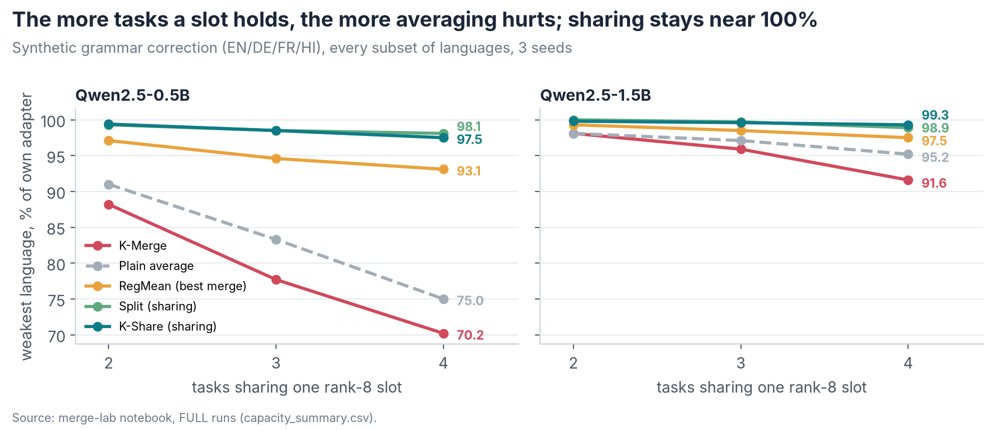
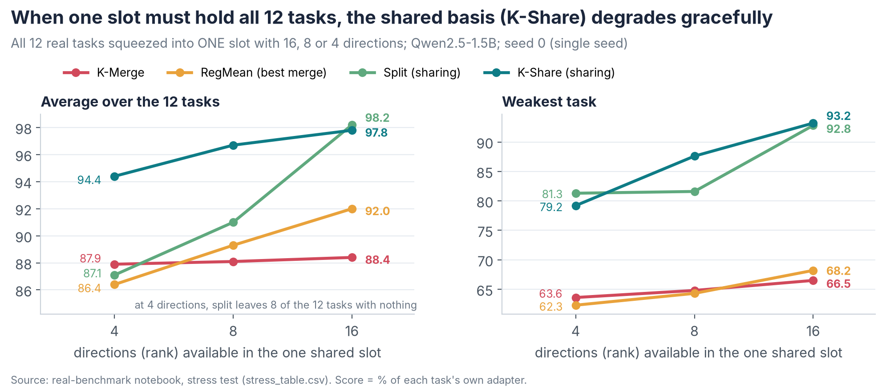
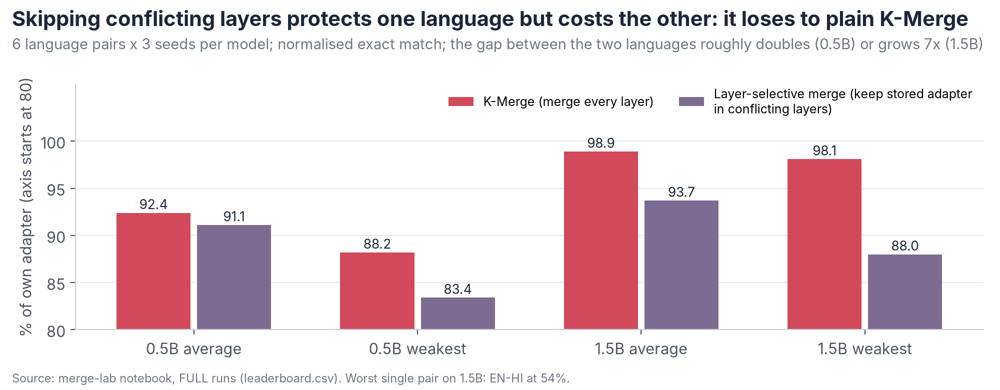

# K-Merge Phase 3: Share the Slot, Don't Average It

5 October 2026 · Ankit Raj Choudhary · Supervisor: Prof. Divya Saxena, IIT Jodhpur (SAIDE)

In K-Merge's on-device setting, most of the damage comes from averaging adapters, not from picking the wrong partner. Keeping each task's own directions inside the slot ("sharing") kept 98.9% of single-adapter quality on 12 real tasks with exactly the same storage (split), against 95.6% for the best merging methods (RegMean, TIES) and 90.8% for K-Merge. On the weakest task: 94.6% vs at most 83.5% vs 65.7% (split vs K-Merge and vs RegMean: paired bootstrap, Holm-corrected p \< 0.001).

## 1\. Summary: five findings

1. **The averaging step causes the damage, not the partner choice.** Over all 24 arrival orders (Qwen2.5-0.5B, 3 seeds), choosing partners better lifted the weakest language from 81.2% to at most 85.7%. Sharing the slot instead of averaging lifted it to 98.8%.
2. **Similarity is not a dependable guide.** Cosine similarity's link to merge damage flipped direction between model sizes: more similar pairs were damaged less on 0.5B (Spearman +0.44 for −cosine vs damage) but more on 1.5B (−0.34). On real data, with K = 2 and a clustered arrival order, K-Merge's cosine rule put 11 of 12 tasks into one slot (both seeds).
3. **Sharing wins on real tasks.** On 12 tasks (grammar correction, summarisation, QA in EN/DE/ES/IT) with K = 2 slots: split 98.9% at exactly the same storage (K-Share the same, with 7.9% extra), RegMean 95.6%, K-Merge 90.8%. Of what the adapters learned beyond the base model, K-Merge keeps 64% and sharing 96%.
4. **Crowded slots need a shared basis.** With all 12 tasks in one slot of 4 directions: K-Share 94.4%, split 87.1%, K-Merge 87.9%, RegMean 86.4%. With 16 directions, split and K-Share tie (98.2% vs 97.8%).
5. **Layer-selective merging does not generalise.** Keeping the stored adapter in conflicting layers lost to plain K-Merge on both models (0.5B: 91.1% vs 92.4%; 1.5B: 93.7% vs 98.9%).

What is new: the building blocks are known (split is close to TSV-C, K-Share to JD-Full). New, to our knowledge, is the evidence and diagnosis inside K-Merge's continual setting (split at exactly equal storage), the who-versus-how test, and the crowding regime map. Our own candidate methods are designed but not yet run on GPU.

## 2\. The problem and the question

K-Merge stores at most K LoRA adapters on a device. A new adapter takes a free slot if there is one. Otherwise it is compared with every slot by cosine similarity of the flattened update ΔW = BA (Eq. 5), and averaged into the most similar slot with history weights (Eq. 8). The paper defines a LoRA as its pair of matrices (A, B), so the average is taken over A and B:

$$
L_{\text{slot}} \leftarrow \frac{n \cdot L_{\text{slot}} + L_{\text{new}}}{n + 1}, \qquad L = (A, B)
$$

Here n is the number of tasks already in the slot. At inference, each task uses the slot that holds it (task identity is known).

Your Insight 3 noted that a failure can have two sources: the wrong tasks were grouped together (who), or the averaging rule damaged a reasonable group (how). Phase 1 suggested similarity was a useful guide (DE-FR, the most similar pair, merged best), but Phase 2 found several cases where it was not:

- EN-HI had the highest similarity (0.145, above DE-FR at 0.093), yet the effect was lopsided: Hindi gained +0.04 to +0.16 while English changed by −0.03 to +0.02.
- The DE-FR pair's similarity was highest at rank 4 (0.134), where merging gave no net gain (−0.009 combined), and lowest at rank 32 (0.067), where both languages gained (+0.135 combined).
- DE-FR merged well as a pair, but EN+DE+FR degraded all three languages in 2 of 3 seeds.

So Phase 3 asked one question: is the fix a better similarity measure (who), a better merge (how), or not merging at all (sharing)?

## 3\. What we built and ran

We built every method from its paper's equations (K-Merge's code is not public) and tested them on three test beds. The real benchmark follows the K-Merge paper's own setup (Qwen2.5-1.5B-Instruct, LoRA rank 32, α = 128) on a subset of its 40 tasks: 3 of its 5 problem types and 4 of its 8 languages.

| Test bed | Model | Tasks and data | Adapters | Repeats | Main metric |
|--------------|--------------|---------------------------|--------------|----------------|---------------|
| Merge lab (synthetic) | Qwen2.5-0.5B and 1.5B Instruct | Grammar correction in EN, DE, FR, HI (templated errors); 128 train / 40 validation / 100 test per language | LoRA r = 8, α = 16, on q and v | 3 seeds; every pair, every 3- and 4-language set, all 24 arrival orders | Exact match (also F1, GLEU, edit accuracy) |
| Real benchmark | Qwen2.5-1.5B Instruct | 12 tasks: grammar correction (W&I+LOCNESS EN, Falko-MERLIN DE, COWS-L2H ES, MERLIN IT), summarisation (SAMSum), QA (SQuAD); summarisation and QA machine-translated to DE/ES/IT; 800 train / 150 test per task | LoRA r = 32, α = 128, on q, k, v, o | Seeds 0 and 1; K = 2 and 4; random and clustered arrival orders | Edit F0.5 (grammar), ROUGE-L (summaries), token F1 (QA) |
| Stress test | Same as real benchmark (seed 0 adapters) | All 12 real tasks forced into ONE slot | Slot with 16, 8 or 4 directions | Seed 0 only | Same as real benchmark |

Every score is normalised: the task's score after the slot is built, divided by the same task's own adapter on the same test set (100% = no loss). We report the average over tasks and the weakest task.

**Methods compared (25 in the lab, 11 on real data).**

- K-Merge (Eq. 8 with its cosine slot rule).
- Weight merges: plain average, task arithmetic, SLERP, TIES, DARE, MagMax, KnOTS+TIES, TSV-M, Iso-C.
- Functional merges that need a few inputs: RegMean (32 unlabelled inputs per task), our GRAM variants, and GRAM-G (pseudo-inputs the base model writes from the task description).
- Our earlier lab ideas: layer-selective merge (from Analysis 4), orthogonal-complement merge, soft cascade.
- Sharing: split, K-Share, a storage-exact K-Share, and adaptive or activation-weighted variants (real data only).

**The two sharing methods.** Both keep a slot the size of one LoRA. Because task identity is known, each task reads only its own part:

$$
\text{split:}\;\; \widehat{\Delta W}_t = U_t^{(k)} S_t^{(k)} V_t^{(k)\top},\; k = R/M
$$

$$
\text{K-Share:}\;\; \widehat{\Delta W}_t = U\,G_t\,V^{\top},\; G_t = U^{\top} \Delta W_t V
$$

- **Split** gives each of the M tasks in a slot an equal share of the slot's R directions: its own top singular directions.
- **K-Share** learns one shared set of R directions (U, V) for all tasks in the slot and gives each task a small R × R core G\_t.

Split needs no extra storage. K-Share's cores add n\_tasks × R / 2432 of a slot for Qwen2.5-1.5B (q, k, v, o): 2.0% for 12 tasks at 4 directions, 3.9% at 8 and 7.9% at 16. In the main benchmark (R = 32) they add 7.9% of total storage at K = 2 and 3.9% at K = 4; a slot holding 11 tasks pays 14.5%.

## 4\. Finding 1: averaging, not partner choice, causes most of the damage

Choosing a better partner recovered at most 4.5 points on the weakest language; changing how the slot stores tasks recovered 17.6.

{width=100%}

We ran K-Merge's online procedure for all 24 arrival orders of EN, DE, FR and HI with K = 2 and 3 seeds, and changed one thing at a time.

- **Who is merged:** K-Merge's rule, the most similar pair overall, a distortion-based rule (GRAM-Select), and an oracle that chooses with labelled validation data.
- **How the slot is built:** K-Merge's average, a smarter merge (RegMean-style), or sharing.

On 1.5B the picture is the same at a smaller scale: better partner rules moved the weakest language from 96.1% to between 95.7% and 97.2%, a smarter merge to 98.1%, sharing to 99.4%.

Sharing also removes most of the arrival-order effect: the standard deviation across the 72 runs (24 orders × 3 seeds) fell from 0.026 for K-Merge to 0.004 for K-Share (0.5B). This sharing was strictly online: at each arrival the device re-compressed only its stored slot plus the newcomer. The oracle row is the "validation-guided selection" proposed after Phase 1. It helps a little, but it cannot undo averaging.

## 5\. Finding 2: why a better similarity measure is not the fix

Every test points the same way: similarity scores only choose partners, the loss comes from averaging, and no score we tried predicted K-Merge's loss reliably.

{width=100%}

1. **Cosine's direction is unstable.** Over 36 language outcomes per model (18 K-Merge merges: 6 pairs × 3 seeds), the rank correlation between (−cosine) and damage was +0.44 on 0.5B (more similar pairs were damaged less) and −0.34 on 1.5B (more similar pairs were damaged more).
2. **Better-informed scores do not rescue K-Merge.** Distortion measured on 32 real inputs predicts damage across all methods (ρ = 0.43 on both models), but not for K-Merge merges alone (ρ = 0.18 on 0.5B, 0.005 on 1.5B).
3. **Better partner choice barely helps.** It changed the weakest language by −0.4 to +4.5 points (Finding 1). Even the oracle with labelled data gained at most 3.7 points (0.5B: 81.2% → 84.9%; 1.5B: 96.1% → 97.2%).
4. **On real data, similarity overloads one slot.** With K = 2 and a clustered arrival order, the cosine rule put 11 of 12 tasks into one slot in both seeds (sum\_de alone in the other). There, K-Merge kept 89.0–89.6% on average (weakest task 58.9–66.1%); sharing, with the same grouping, kept 98.6–98.9% (weakest 93.6–94.2%).
5. **Phase 2 showed the same pattern.** The most similar pairs (EN-HI; DE-FR at rank 4) were not the most compatible.
6. **Weight-only signals mislead for LoRA (F6).** A merge that uses the adapters' own weights as a stand-in for input statistics collapsed to 4.8% (0.5B) and 53.3% (1.5B). LoRA's A matrices stay close to their random start (Zhu et al., 2024), so weight statistics mostly reflect that start, not the task's inputs.

In your Insight 25's terms: similarity describes parameters before merging; mergeability describes function after. Our data add that even reasonable partners lose under averaging, so the lever is how the slot stores tasks. We do not claim cosine is useless in general; in these tests it was neither a stable predictor nor the lever that mattered.

## 6\. Finding 3: sharing keeps almost everything, at the same storage

With exactly the storage of one LoRA per slot, split kept 98.9% of single-adapter quality on 12 real tasks, against 95.6% for the best merges (RegMean, TIES) and 90.8% for K-Merge; K-Share matched split while using 7.9% more storage.

{width=100%}

Every method uses K-Merge's own slot grouping, so only the way the slot is built differs. Differences in points of normalised score, 95% CI, Holm-corrected p:

| Comparison | K | Average (95% CI) | Weakest task (95% CI) | p |
|------------------------|------|-------------------------|---------------------------|----------|
| Split − K-Merge | 2 | +8.1 (+6.3 to +9.8) | +28.9 (+19.3 to +37.7) | \< 0.001 |
| Split − RegMean | 2 | +3.3 (+1.8 to +4.6) | +16.0 (+9.0 to +23.6) | \< 0.001 |
| K-Share − Split | 2 | +0.0 (−0.4 to +0.5) | +0.1 (−1.3 to +1.5) | 1.0 |
| Split − K-Merge | 4 | +5.7 (+4.0 to +7.3) | +25.4 (+16.4 to +34.5) | \< 0.001 |
| Split − RegMean | 4 | +2.2 (+0.9 to +3.4) | +13.1 (+7.8 to +19.5) | \< 0.001 |

**How much of what the adapters learned survives.** The base model alone already reaches 79% of the adapters' scores on average, so normalised scores flatter every method. Measuring only the gain over the base model shows the gap more clearly:

{width=100%}

Grammar correction is hit hardest: K-Merge keeps 36% of its gain, sharing 93–94%.

**What the outputs look like.** Real learner sentences from the run where 11 tasks share one slot (K = 2, clustered order, seed 0). Each was fixed correctly by its own adapter and by K-Share; all are shown as written.

| Language | Learner sentence | K-Merge output | K-Share output |
|-----------|------------------------------|------------------------------|-----------------------------|
| EN | I suppose we'll see each other soon and I'll be capable of talking to you about this experience. | I suppose we'll see each other soon, and I'll be capable of talking to you about this experience. | I suppose we'll see each other soon and I'll be able to talk to you about this experience. |
| DE | Wie oft hat die heutige Jugend diese Satz gehört? | Wie oft hat die heutige Jugend diese Satz gehört? (unchanged) | Wie oft hat die heutige Jugend diesen Satz gehört? |
| ES | El dia era muy terrible y yo estaba muy triste. | El día era muy triste y yo estaba muy triste. (meaning changed) | El día era muy terrible y yo estaba muy triste. |
| IT | Mi piace di rivedervi e di festeggiare insieme. | Mi piace di rivedervi e di festeggiare insieme. (unchanged) | Mi piace rivedervi e festeggiare insieme. |

These examples were chosen to show the two failure types; the rates are what count. Across the four grammar tasks (K = 2), own adapters made 34.6% of sentences fully correct, K-Share 33.9%, RegMean 28.9% and K-Merge 24.1%. In the run where the four grammar adapters shared one slot, K-Merge left sentences unchanged more often than the own adapter (25.8% vs 19.4% of sentences that needed a fix): dilution. In the 11-task slot it made wrong edits instead (fully correct 22.5% vs 34.6%): interference.

**Synthetic results agree, across all 25 methods.** On the 0.5B lab, sharing kept 99.8% on language pairs, RegMean 98.5%, K-Merge 92.4%. A K-Share variant that fits basis and cores inside exactly one slot kept 99.7%, so the result holds at exactly equal storage.

{width=100%}

Adding tasks to a slot hurts averaging more and more, while sharing stays near 100%:

{width=100%}

On 1.5B the synthetic task is close to saturated (K-Merge keeps 98.9% on pairs), so the effects are smaller. With 4 languages per slot, K-Share kept 99.3% on the weakest language against 91.6% for K-Merge. On language pairs, K-Share and RegMean tied on average (+0.06 points, p = 0.75); K-Share was 0.5 points ahead on the weaker language, which is not significant after correction (Holm p = 0.09).

## 7\. Finding 4: in a crowded slot, a shared basis beats a plain split

When all 12 tasks must share one slot with only 4 or 8 directions, K-Share keeps 94.4–96.7% while split drops to 87.1–91.0%.

{width=100%}

Split runs out of directions: with 4 directions for 12 tasks, 8 tasks get none and fall back to the base model. K-Share finds directions that serve all tasks and gives each a small core, so every task keeps something.

| Comparison | Storage of the left method vs the right | Average difference (95% CI) | Holm-corrected p |
|--------------------------|----------------------------|----------------------------|------------------|
| K-Share 4 − split 4 | +2% | +7.3 (+5.2 to +9.2) | \< 0.001 |
| K-Share 8 − split 8 | +3.9% | +5.7 (+4.0 to +7.4) | \< 0.001 |
| K-Share 16 − split 16 | +7.9% | −0.4 (−1.6 to +0.7) | 1.0 |
| K-Share 4 − split 8 | 51% of split's | +3.4 (+1.5 to +5.3) | \< 0.005 \* |
| K-Share 8 − split 16 | 52% of split's | −1.5 (−2.9 to −0.0) | 0.08 \* |
| K-Share 4 − RegMean 16 | 25% of RegMean's | +2.5 (+1.0 to +3.9) | 0.003 \* |
| K-Share 4 − K-Merge 16 | 25% of K-Merge's | +6.0 (+4.1 to +7.8) | \< 0.005 \* |

\* Computed afterwards from the saved per-example results (same paired bootstrap, 2,000 draws), Holm-corrected over the 10 extra comparisons we ran.

- **Weakest task.** At 8 directions K-Share's weakest task kept 87.6% against K-Merge's 64.8% (+22.8, 95% CI +11.5 to +32.6, Holm p \< 0.005). It was also above split's 81.6%, but that gap is not significant after correction (p = 0.30). At 4 directions split's weakest task (81.3%) was slightly above K-Share's (79.2%), also not significant: split's floor is the base model itself.
- **Share of the learned gain kept** (4 / 8 / 16 directions): K-Share 79% / 87% / 91%, split 25% / 48% / 92%, K-Merge 49% / 51% / 53%.
- **Regime map (your Insight 33).** While every task can have at least one direction, a plain split is enough. Once tasks outnumber directions, split collapses and K-Share degrades gracefully.
- **Variants.** Adaptive allocation helped when crowded (90.7% vs split's 87.1% at 4 directions) but lost at 16 (96.0% vs 98.2%). Activation-weighted variants stayed within 0.2 points of split on the main benchmark (none significant).

This test used one seed; seeds 1 and 2 are the first item in Section 14.

## 8\. Finding 5: layer-selective merging does not generalise

Keeping the stored adapter in conflicting layers, the idea behind Analysis 4, lost to plain K-Merge on both models, because the other language pays for the protected one.

{width=100%}

Analysis 4 (seed 0) measured French only: French recovered from 0.860 to 0.944 when layers 17–21 kept French's weights. The lab version picks conflicting layers per pair (subspace overlap below a threshold chosen on validation data) and measures both languages over 6 pairs and 3 seeds.

- **Average:** 91.1% vs K-Merge's 92.4% (0.5B) and 93.7% vs 98.9% (1.5B).
- **Imbalance between the two languages:** rose from 0.083 to 0.153 (0.5B) and from 0.017 to 0.114 (1.5B). The worst pair, EN-HI on 1.5B, fell to 54%.
- **Location moves.** Where conflict peaks changes with model and pair. With the lab's 1.5B adapters (a different training setup from Analysis 4), the peak layer was 27 for DE-FR, 8 for EN-FR and 0 for EN-HI. On 0.5B (24 layers), three pairs peaked at layers 22–23, two at 18 and EN-DE at 0.

So layer analysis is a good diagnostic probe, as your RQ5 suggested, but not a merge rule.

## 9\. Why sharing works, in plain words

Adapters for different languages and task types point in almost unrelated directions, so averaging mostly shrinks each one, while sharing keeps each task's strongest directions intact.

- **Averaging dilutes.** Adapter updates for different tasks point in mostly unrelated directions (cosine mostly below 0.3, i.e. more than 70° apart). Averaging n of them leaves each task about 1/n of its own update, plus pieces of the others that act like noise.
- **K-Merge's factor averaging adds its own damage.** Eq. 8 averages A and B separately, which creates cross terms (B₁A₂ and B₂A₁) that no task learned. It scored below a plain average of the full updates (0.5B lab: 92.4% vs 94.1%; real data: 90.8% vs 91.8%).
- **Sharing avoids both problems.** A slot's R directions are like shelf space. Split gives each task its own shelf; because the device knows which task is asked, each task reads only its shelf: no dilution, no cross terms.
- **K-Share helps when shelves run out.** When tasks outnumber shelves, K-Share builds one set of shelves useful to all tasks and gives each task a small personal index (its core).

| Code | Failure mode | What it looks like | Evidence |
|------|------------------|--------------------------|--------------------------------------------------|
| F1 | Dilution | Output left unchanged | Copy rate 10.4% for K-Merge vs 1.6% for sharing (0.5B pairs); 25.8% for K-Merge vs 19.4% for the own adapter in a real four-grammar slot |
| F2 | Interference | Wrong edits, meaning changes | Real 11-task slot: fully correct 22.5% vs 34.6% for the own adapter |
| F3 | Truncation loss | Directions lost when a full-rank merge is cut back to rank R | DARE loses 57% of its merged update's energy, TIES 21% (0.5B pairs) |
| F4 | One adapter dominates | The larger update wins | Mixed: Spearman +0.68 for K-Merge on 1.5B, −0.34 on 0.5B |
| F5 | Similarity is not compatibility | Similar pairs merge badly | Cosine's link to damage flips sign; EN-HI; rank ablation |
| F6 | Weight-only signals mislead | Statistics from LoRA weights reflect the random start | Self-Gram merges: 4.8% (0.5B), 53.3% (1.5B) |

## 10\. What is new and what is not

The parts are known; the setting, the evidence and the diagnosis are, to our knowledge, new.

| Item | Status | Closest prior work |
|------------------------------------------|----------------------------|------------------------------|
| Split: each task keeps its top directions | Known | TSV-C (Gargiulo et al., CVPR 2025); per-task pieces also in TALL masks and EMR-Merging |
| K-Share: shared basis + small per-task core | Known | JD-Full in Compress then Serve (Brüel-Gabrielsson et al., ICML 2025) |
| GRAM, our closed-form functional merge | Same as RegMean on 0.5B (+0.01 points, p = 0.94); 0.2 points lower on 1.5B (p = 0.01, uncorrected) | RegMean (Jin et al., ICLR 2023) |
| GRAM-Select: partner choice by predicted distortion | Tested; no better than choosing the most similar pair overall | — |
| Sharing beats every merge we tested in K-Merge's continual setting on real multilingual tasks (split at exactly equal storage; real-data slots rebuilt from the original adapters, strictly online only in the synthetic lab) | New to our knowledge | K-Merge (Shenaj et al., ACL 2026) compares merges only |
| Who-versus-how test (partner rule × slot rule, with an oracle) | New to our knowledge | Answers your Insight 3 |
| Crowding regime map (split collapses when tasks outnumber directions; K-Share does not) | New to our knowledge; one seed so far | — |
| Diagnosis of K-Merge's failure (factor averaging, unbalanced cosine slotting, dilution + interference measured) | New to our knowledge | — |
| F6: weight-only statistics fail for LoRA merging | Consistent with LoRA asymmetry (Zhu et al., ICML 2024); not reported for LoRA merging as far as we found | WUDI (Cheng et al., ICML 2025) |
| Our candidate methods: K-Share+ (shared + private directions), K-Share-fair, and strictly online sharing on real data (so far tested only in the synthetic lab) | Designed; not yet run on GPU | — |

## 11\. Proof: how the numbers were tested

Every headline difference comes with a 95% confidence interval from a paired bootstrap; p-values are Holm-corrected unless marked otherwise.

- **Same examples for every method.** Each bootstrap draw resamples test examples with replacement and re-scores every method on that same resample: 2,000 draws on real data, 4,000 on synthetic.
- **Confidence intervals and p-values.** The 95% CI is the 2.5–97.5 percentile range. The two-sided p is twice the smaller tail. Holm's correction is applied within each family of comparisons; the few uncorrected values are marked. Synthetic exact matches also get McNemar's test.
- **No tuning on test data.** Merge hyper-parameters were chosen on a separate validation split (synthetic).
- **Only the slot rule differs.** On real data all methods share K-Merge's own slot grouping.
- **Sentence counts.** On 0.5B pairs, K-Share fixed 270 sentences that K-Merge got wrong and lost 21 (McNemar p \< 0.001).
- **Repeats.** Synthetic: 3 seeds. Real: 2 seeds × 2 arrival orders. Stress: 1 seed.
- **Reproducible.** Two Kaggle notebooks: kmerge-merge-lab-1 (version 4 for 0.5B, version 5 for 1.5B) and kmerge-real-benchmark (version 8, which holds the version 7 main run and the stress test). Every run saved its predictions, per-example scores and summary tables. I can share them on request.

## 12\. Limits and corrections

These limits bound what can be claimed today.

- **Repeats:** the stress test has one seed and the real benchmark two.
- **Models:** one model family (Qwen2.5), two sizes (0.5B and 1.5B). The K-Merge paper also used Llama-3.2-1B.
- **Scale:** 12 tasks, against 40 in the K-Merge paper.
- **Data:** summarisation and QA in DE, ES and IT are machine-translated (OPUS-MT). Hindi appears only in the synthetic lab; we found no downloadable real Hindi grammar data.
- **Metric:** the grammar metric is an edit-level F0.5 from word alignment, close to but not the same as ERRANT.
- **Assumptions shared with K-Merge:** task identity is known at inference.
- **Rebuild setting:** on real data, slots were built from the original adapters after all arrivals. Strictly online sharing (keeping only the compressed slot) was tested only in the synthetic lab.
- **Storage correction.** Earlier notes put K-Share's extra storage at "about 1–3%". That holds only at 4 directions (2.0%): it is 3.9% at 8 and 7.9% at 16. In the main benchmark the cores add 7.9% of total storage at K = 2, and 14.5% for the slot holding 11 tasks. Split has no overhead and already gives the main real-data result. A storage-exact K-Share was tested only on synthetic data (99.7%).
- **Metric caveat:** normalised scores look high for every method because the base model alone reaches 79% of the adapters' scores. Gain retained (Section 6) shows the gaps more fairly.
- **Correction to the Phase 2 report:** its Priority 8 text says English lost in 2 of 3 EN-HI seeds; its own table shows a loss in 1 of 3 (seed 0: −0.028).
- **Open checks:** the Phase 1 consistency items (your items 20–21: the seed-0 DE-EN rows and the per-seed similarities behind each selected pair) are not yet re-verified. These results are not yet in the shared Google Doc.

## 13\. Your research questions: answers so far

| Question | What we did | Answer so far |
|--------------------------|--------------------------------|------------------------------------------|
| RQ1 What makes two adapters mergeable? | Tested cosine, weight-only distortion, and distortion on generated and on real inputs against damage after merging | No score predicted K-Merge's damage reliably; cosine flipped sign between models; distortion on inputs predicted best across methods (ρ 0.43–0.50) |
| RQ2 Does pairwise mergeability compose? | Every 2-, 3- and 4-language slot | Averaging degrades as tasks are added (0.5B weakest: 88.2% → 77.7% → 70.2%); split and K-Share stay near 97.5% or above |
| RQ3 How does merge history change things? | All 24 arrival orders, online | K-Merge depends on arrival order (spread 0.026); sharing almost removes it (0.004) |
| RQ4 Why does positive transfer occur? | Not tested directly; some tasks score above their own adapter (e.g. QA under sharing and RegMean) | Open |
| RQ5 Where does interference occur? | Per-layer functional conflict; layer-selective merge | Location varies with model and pair; skipping layers trades one task for another, so use it as a probe |
| RQ6 Is there a stable boundary? | Tasks per slot versus directions (capacity and stress tests) | Tentatively yes (one seed): split works while each task has at least one direction; beyond that K-Share degrades gracefully |
| RQ7 What shapes cross-lingual geometry? | EN/DE/FR/HI and EN/DE/ES/IT | Cosine groups tasks by type more than by language (e.g. all four grammar adapters in one slot); deeper analysis open |

## 14\. What is left

About 17–19 GPU hours of work remain, which fits within one week of Kaggle's free quota (30 hours).

| Item | Why it matters | GPU time | Status |
|--------------------------------|----------------------------|------------|----------------------------|
| Stress test, seeds 1 and 2 | The crowding result has one seed | \~2.5 h each | Ready to run |
| Real benchmark, seed 2 | Third seed for the main claims | \~4.5 h | Ready to run |
| Pilot of our candidate methods | The part that could become our own method | \~1 h | Designed; implementation and CPU tests in progress |
| Storage-exact K-Share on real data | Equal-storage proof for K-Share | \< 1 h | Small change |
| Second model family (Llama-3.2-1B, K-Merge's other model) | Generality beyond Qwen | \~5 h | Small code change |
| KnOTS baseline on real data | Reviewers will ask | \< 1 h | Code exists in the lab |
| Analysis 4 on 3 seeds | Closes the Phase 2 item | \~1 h | Not started |
| On-device cost (rebuild time, memory) | Supports the on-device claim | CPU / phone | Not started |
| Real Hindi grammar data | Hindi on real data | — | Need data from the authors of a Hindi corpus |
| Phase 1 consistency checks | Your items 20–21 | CPU | Not started |
| Add results to the shared Google Doc | Your request | — | Need edit access |
| Paper draft | — | — | After the first four items |

## 15\. Next steps and new study directions

The next four weeks close the evidence gaps; the five directions below could each become a study of its own.

**Plan**

1. Week 1 (after the GPU quota resets): stress seeds 1–2, real seed 2, the candidate-method pilot, storage-exact K-Share.
2. Week 2: Llama-3.2-1B run, KnOTS baseline, Analysis 4 on 3 seeds.
3. Weeks 3–4: on-device timing, paper draft, results into the shared Google Doc.

**New study directions**

- **A. How many tasks can one slot hold?** Measure quality as a function of directions per task and of how much the tasks' subspaces overlap. The aim is a capacity rule that says when split is enough and when a shared basis is needed. This changes the question from "which adapters are similar?" to "how much room does each task need?"
- **B. Truly on-device sharing.** Keep only the slot, never the original adapters, and update the shared basis as each adapter arrives. Then test long streams (40 or more tasks, as in K-Merge) for drift.
- **C. No task label at inference.** Route each request to its task's core using the shared basis itself, building on adapter routing such as Arrow (Ostapenko et al., ICML 2024). This would remove K-Merge's strongest assumption.
- **D. A function-based compatibility score.** Find a cheap score from a few unlabelled inputs that predicts which tasks can share a basis. Distortion measured on inputs (real or generated) is the best signal so far (ρ ≈ 0.43–0.50 across methods).
- **E. Real phone measurement.** Measure memory and latency of K-Share against K-Merge on an Android phone.

## Sources

- [K-Merge: Online Continual Merging of Adapters for On-device Large Language Models](https://arxiv.org/abs/2510.13537) (Shenaj et al., ACL 2026); experimental setup and Eq. 5/Eq. 8 read from the [paper PDF](https://arxiv.org/pdf/2510.13537v1)
- [LoRA: Low-Rank Adaptation of Large Language Models](https://arxiv.org/abs/2106.09685) (Hu et al., ICLR 2022)
- [Task Singular Vectors: Reducing Task Interference in Model Merging](https://arxiv.org/abs/2412.00081) (Gargiulo et al., CVPR 2025)
- [Compress then Serve: Serving Thousands of LoRA Adapters with Little Overhead](https://arxiv.org/abs/2407.00066) (Brüel-Gabrielsson et al., ICML 2025)
- [Dataless Knowledge Fusion by Merging Weights of Language Models (RegMean)](https://arxiv.org/abs/2212.09849) (Jin et al., ICLR 2023)
- [TIES-Merging: Resolving Interference When Merging Models](https://arxiv.org/abs/2306.01708) (Yadav et al., NeurIPS 2023)
- [Language Models are Super Mario (DARE)](https://arxiv.org/abs/2311.03099) (Yu et al., ICML 2024)
- [Editing Models with Task Arithmetic](https://arxiv.org/abs/2212.04089) (Ilharco et al., ICLR 2023)
- [EMR-Merging: Tuning-Free High-Performance Model Merging](https://arxiv.org/abs/2405.17461) (Huang et al., NeurIPS 2024)
- [Localizing Task Information for Improved Model Merging and Compression (TALL masks)](https://arxiv.org/abs/2405.07813) (Wang et al., ICML 2024)
- [No Task Left Behind: Isotropic Model Merging (Iso-C)](https://arxiv.org/abs/2502.04959) (Marczak et al., ICML 2025)
- [Model Merging with SVD to Tie the KnOTS](https://arxiv.org/abs/2410.19735) (Stoica et al., ICLR 2025)
- [MagMax: Leveraging Model Merging for Seamless Continual Learning](https://arxiv.org/abs/2407.07523) (Marczak et al., ECCV 2024)
- [Asymmetry in Low-Rank Adapters of Foundation Models](https://arxiv.org/abs/2402.16842) (Zhu et al., ICML 2024)
- [Whoever Started the Interference Should End It (WUDI)](https://arxiv.org/abs/2503.08099) (Cheng et al., ICML 2025)
- [Towards Modular LLMs by Building and Reusing a Library of LoRAs (Arrow)](https://arxiv.org/abs/2405.11157) (Ostapenko et al., ICML 2024)
- Data: W&I+LOCNESS (BEA-2019), Falko-MERLIN, COWS-L2H, MERLIN, SAMSum, SQuAD; translation with OPUS-MT; base models Qwen2.5-0.5B and 1.5B Instruct.
- Phase 1 and Phase 2 numbers: K\_Merge\_Phase2\_Report\_Pro and the Phase 1 report.
